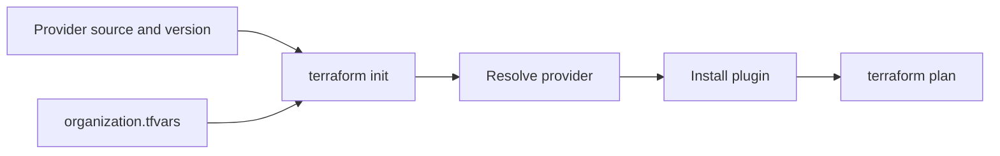
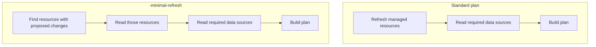

# Terraform 1.17.0: Two Small Changes Worth Noticing

*Terraform 1.17.0 was released on October 21, 2026. With so much attention on AI, I nearly missed a couple of useful Terraform improvements.*

## Variables in provider requirements

Terraform 1.17.0 lets `required_providers` use constant variables and locals for both the provider source and version. That helps teams use the same configuration with different private registry namespaces or centrally managed provider versions, without editing the requirement block for each environment.

```hcl
terraform {
    required_providers {
        random = {
            source  = "app.terraform.io/${var.organization}/random"
            version = local.random_version
        }
    }
}

varaible "organization" {
    type  = string
    const = true
}

locals {
    random_version = "3.9.0"
}
```

Here, organization selects the private registry namespace and the local keeps the version in one place. `terraform init` resolves and installs provider plugins before planning can produce resource values, so it needs the source address and version up front. Constant values make that possible while keeping the configuration reusable; they cannot depends= on results produced during planning. See the [provider requirement changes](https://github.com/hashicorp/terraform/pull/39153)

Supply the organization value when initializing. For example, put this in `organization.tfvars`:

```hcl
organization = "example-team"
```

Then run:

```sh
terraform init -var-file="organization.tfvars"
```



## A lighter refresh during planning

`-minimal-refresh` can skip refreshing managed resources taht have no proposed changes. To compare it with a regular plan, run both from the same directory with the same variables, credentials, and state. These commands create actual saved plans and capture the refresh logs:



1. Change into example directory.

   ```sh
   cd example/directory
    ```
2. Run a standard plan and capture its output:

   ```sh
   terraform plan -out=standard.tfplan 2>&1 | tee standard-plan.log
   terraform show standard.tfplan
   ```

   ```text
   data.aws_eks_cluster.eks_cluster: Reading...
    module.sqs.data.aws_partition.this: Read complete after 0s [id=aws]
    module.xyz_kb.data.aws_partition.this: Read complete after 0s [id=aws]
    data.awscc_devopsagent_agent_space.xyz_agent_space: Reading...
    module.xyz_kb.data.aws_caller_identity.this: Read complete after 0s [id=111111111111]
    module.xyz_kb.data.aws_region.this: Reading...
    module.s3-cmk.data.aws_caller_identity.current: Read complete after 0s [id=111111111111]
    module.s3-cmk.data.aws_partition.current: Reading...
    module.xyz_kb.data.aws_region.this: Read complete after 0s [id=us-east-1]
    data.aws_region.current: Reading...
    module.s3-cmk.data.aws_partition.current: Read complete after 0s [id=aws]
    data.aws_caller_identity.current: Reading...
    data.aws_iam_policy_document.xyz_dynamodb: Reading...
    data.aws_iam_policy_document.xyz_kms: Reading...
    data.aws_iam_policy_document.xyz_dynamodb: Read complete after 0s [id=1111111111]
    data.aws_iam_policy_document.xyz_kms: Read complete after 0s [id=1111111111]
    data.aws_iam_policy_document.xyz_sqs: Reading...
    data.aws_iam_policy_document.xyz_trust: Reading...
    data.aws_subnets.private: Reading...
    data.aws_iam_policy_document.xyz_trust: Reading...
    data.aws_vpc.main: Reading...
    data.aws_iam_policy_document.xyz_trust: Read complete after 0s [id=1111111111]
    data.aws_iam_policy_document.xyz_trust: Read complete after 0s [id=1111111111]
    module.sqs.data.aws_iam_policy_document.this[0]: Reading...
    module.sqs.data.aws_iam_policy_document.this[0]: Read complete after 0s [id=1111111111]
    data.aws_subnets.private: Read complete after 0s [id=us-east-1]
    data.aws_subnet.private_details["subnet-1111111111"]: Reading...
    data.aws_subnet.private_details["subnet-1111111111"]: Reading...
    data.aws_subnet.private_details["subnet-1111111111"]: Reading...
    data.aws_subnet.private_details["subnet-1111111111"]: Reading...
    No changes. Your infrastructure matches the configuration.
    Terraform has compared your real infrastructure against your configuration
    and found no differences, so no changes are needed.
   ```

3. Run the same plan with minimal refresh:

   ```sh
   terraform plan -minimal-refresh -out=minimal-refresh.tfplan 2>&1 | tee minimal-refresh-plan.log
   terraform show minimal-refresh.tfplan
   ```

   ```text
   data.aws_eks_cluster.eks_cluster: Reading...
    data.awscc_devopsagent_agent_space.xyz_agent_space: Reading...
    data.aws_region.current: Reading...
    data.aws_caller_identity.current: Reading...
    data.aws_iam_policy_document.xyz_dynamodb: Reading...
    data.aws_iam_policy_document.xyz_kms: Reading...
    data.aws_iam_policy_document.xyz_dynamodb: Read complete after 0s [id=1111111111]
    data.aws_iam_policy_document.xyz_kms: Read complete after 0s [id=1111111111]
    data.aws_iam_policy_document.xyz_sqs: Reading...
    data.aws_iam_policy_document.xyz_trust: Reading...
    data.aws_subnets.private: Reading...
    data.aws_iam_policy_document.xyz_trust: Reading...
    data.aws_vpc.main: Reading...
    data.aws_iam_policy_document.xyz_trust: Read complete after 0s [id=1111111111]
    data.aws_iam_policy_document.xyz_trust: Read complete after 0s [id=1111111111]
    data.aws_subnets.private: Read complete after 0s [id=us-east-1]
    data.aws_subnet.private_details["subnet-1111111111"]: Reading...
    data.aws_subnet.private_details["subnet-1111111111"]: Reading...
    data.aws_subnet.private_details["subnet-1111111111"]: Reading...
    data.aws_subnet.private_details["subnet-1111111111"]: Reading...
    No changes. Your infrastructure matches the configuration.
    Terraform has compared your real infrastructure against your configuration
    and found no differences, so no changes are needed.
   ```

- **Why use it:** On a large configuration or state, fewer provider refreshes can shorten planning and let you review and start an apply sooner. It does not make the apply operation themselves faster.
- **Keep in mind:** A skipped resource may have drift Terraform has not discovered. Use regular plan when you need a full refresh and drift check.
- **Timing:** These captures show refresh behavior, not elapsed time. Treat faster planning as a potential benefit, not a measured result from this comparison.

Terraform keeps getting practical improvements while the industry chases AI. These two are easy to miss, and worth a look if provider versions are duplicated across your configuration or plans spend time refreshing unchanged resources.

**Release and details:** [Terraform 1.17.0 release notes]\([https://github.com/hashicorp/terraform/releases/tag/v1.17.0](https://github.com/hashicorp/terraform/releases/tag/v1.17.0)), [provider requirements change]\([https://github.com/hashicorp/terraform/issues/39153](https://github.com/hashicorp/terraform/issues/39153)), [\`-minimal-refresh\` change]\([https://github.com/hashicorp/terraform/issues/35290](https://github.com/hashicorp/terraform/issues/35290)).

Terraform 1.17.0 also includes other enhancements and bug fixes. This post focuses on the new features most useful to my organization; see the [official release notes]\([https://github.com/hashicorp/terraform/releases/tag/v1.17.0](https://github.com/hashicorp/terraform/releases/tag/v1.17.0)) for the full list.

**AI disclosure:** I used AI to help write this post.

Thanks to the Terraform community for these much-needed features.
